# Checked state machines and user flows

Reviewed on 2026-11-11 against source commit `d91fec94f4641afd646336f1ce128620676c4999`. This verification package does not change product source.

Eight subsystem skills, eight finite models, 26 configured rules, and eight scratch Swift regressions with matching model negative controls. Eight rule violations remain visible. The existing Swift suite passed 18 tests.

The checker exits 1 while known findings remain. These results establish the finite models and the recorded source replays; they do not prove framework behavior, physical hardware behavior, or all Swift executions.

## Findings and evidence

| Subsystem | Rule | Shortest source-level path | Evidence and limit |
| --- | --- | --- | --- |
| Screen recording | `NoAppendAfterFinish` | Start → capture a frame → stop request → stop timeout → finalization → late frame | Actual callback/stop/finalize methods with injected late callback and ready input; real ScreenCaptureKit scheduling still needs validation. |
| Camera | `ExplicitStopOnError` | Access granted → start → frame timeout → process exit | Actual start/defer/frame-wait code and actual `Out.fail`; verifies missing explicit stop, not a camera persisting after process teardown. |
| DMG | `ErrorUnmountsImage` | Mount → no app → process exit | Actual command body; fake mount receives no detach call. A real image is never mounted. |
| DMG | `FailedReplacementKeepsOldApp` | Mount → approval → delete old app → copy failure | Actual command body calls destination removal before the failed copy; no restoration. |
| DMG | `CleanupReportIsTrue` | Mount → approval → copy → cleanup failure → success | Actual command body suppresses deletion error and prints “dmg removed”. |
| Fan control | `FailureRestoresAutomatic` | Approval → forced bit enabled → target-write failure | Actual Set.run leaves the fake forced bit set; physical firmware behavior is outside scope. |
| Keep-awake | `InterruptEventuallyReleases` | Acquire assertion → Ctrl-C → repeat indefinitely | Actual run body uses real main-queue signal dispatch and Thread.sleep; fixture assertion remains unreleased until the test child is killed. |
| Usage index | `CumulativeUsageIsMaximum` | Cache total 10 → append cumulative total 15 → total 25 | Actual scanFile/codexTokens over scratch JSONL; unchanged cache stays 25, full reindex models recovery to 15. |

## Running and maintaining the checks

```sh
python3 formal/check.py --mutations
python3 formal/check.py --subsystem dmg-install --mutations
```

The source manifest is [coverage.json](coverage.json); the verifier and replay instructions are in [README.md](README.md). Source changes require reviewing the transition boundaries and deliberately advancing the synchronization record. Use `/maintain-formal-verification-skill` after changes that did not recheck the model.

For visual regeneration, invoke the installed `/statechart` skill with a scratch copy of each model/config/view and a new output directory. Render the resulting Mermaid with Pele 1.9.0. The views hide terminal stuttering actions and merge internal steps that do not change the reader-visible label. In particular, per-item file-move steps stay inside the applying state. The full TLC models retain these transitions.

## Record a screen video

[Subsystem skill](../.agents/skills/screen-recording/SKILL.md) · [TLC report](results/screen-recording/report.md) · [SVG](results/screen-recording/chart.svg) · [Source replay evidence](results/screen-recording/evidence.json)

One stream, one accepted frame, one stream failure, and one late callback; acknowledgement and timeout are distinct. The replay runs actual callback, stop and finish methods with fake framework objects. It does not record a real display or prove ScreenCaptureKit callback timing.


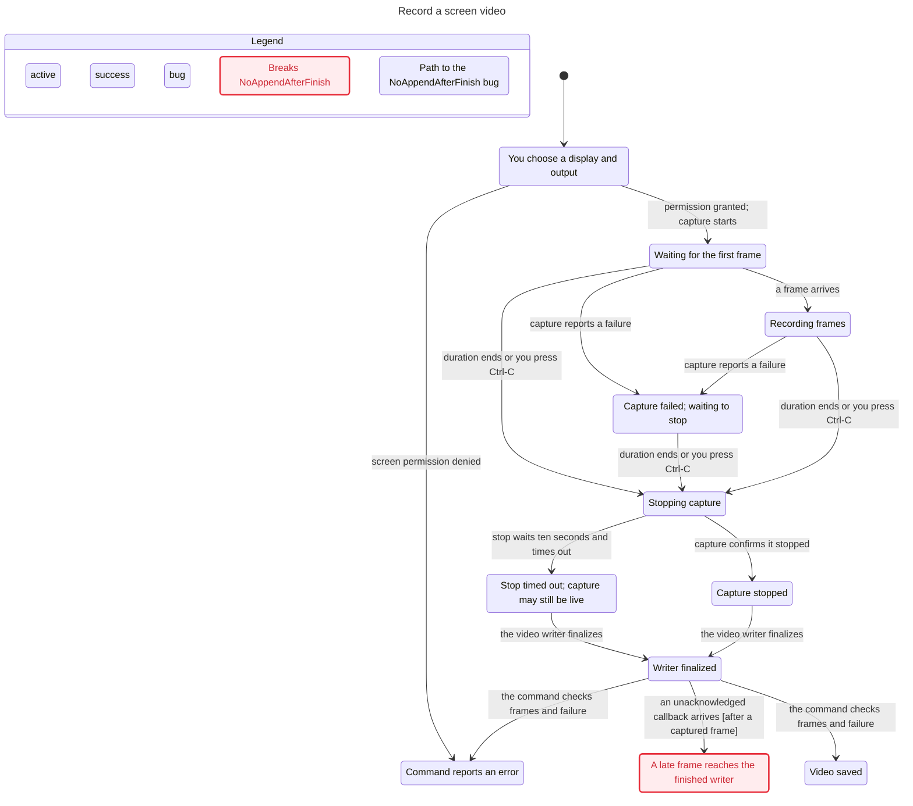

## Preview and clean files

[Subsystem skill](../.agents/skills/file-operations/SKILL.md) · [TLC report](results/file-operations/report.md) · [SVG](results/file-operations/chart.svg) · [Source replay evidence](results/file-operations/evidence.json)

Two selected cache entries with independent success/failure. The replay executes the actual cleaner body with a fake filesystem and real output/confirmation logic. Target discovery, app-uninstall matching, Downloads collisions, permanent Trash emptying, settings import and concurrent filesystem replacement are excluded.


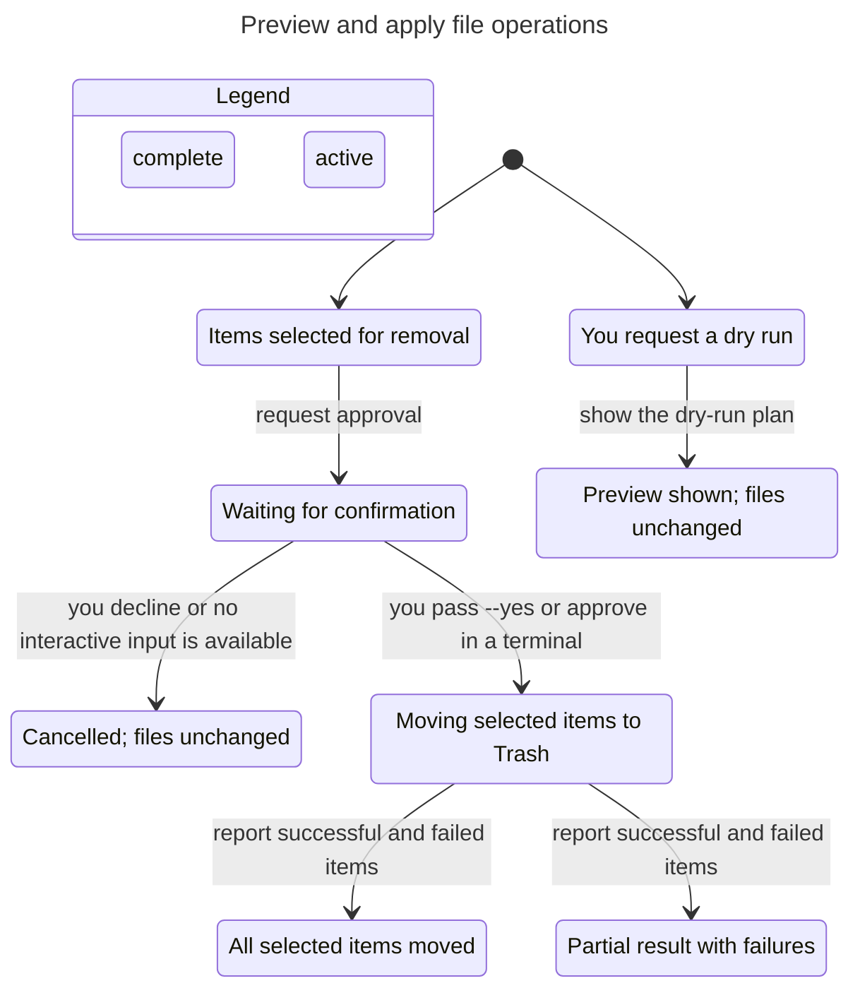

## Install an app from a DMG

[Subsystem skill](../.agents/skills/dmg-install/SKILL.md) · [TLC report](results/dmg-install/report.md) · [SVG](results/dmg-install/chart.svg) · [Source replay evidence](results/dmg-install/evidence.json)

One existing app and one image; mount, find-app, confirmation, removal, copy, cleanup and detach are separate steps. The actual command body runs against fake filesystem and process dependencies. No disk image is mounted; subprocess internals, crash recovery and concurrent installs are excluded. Detach failure is represented but no unconditional successful-detach guarantee is asserted.


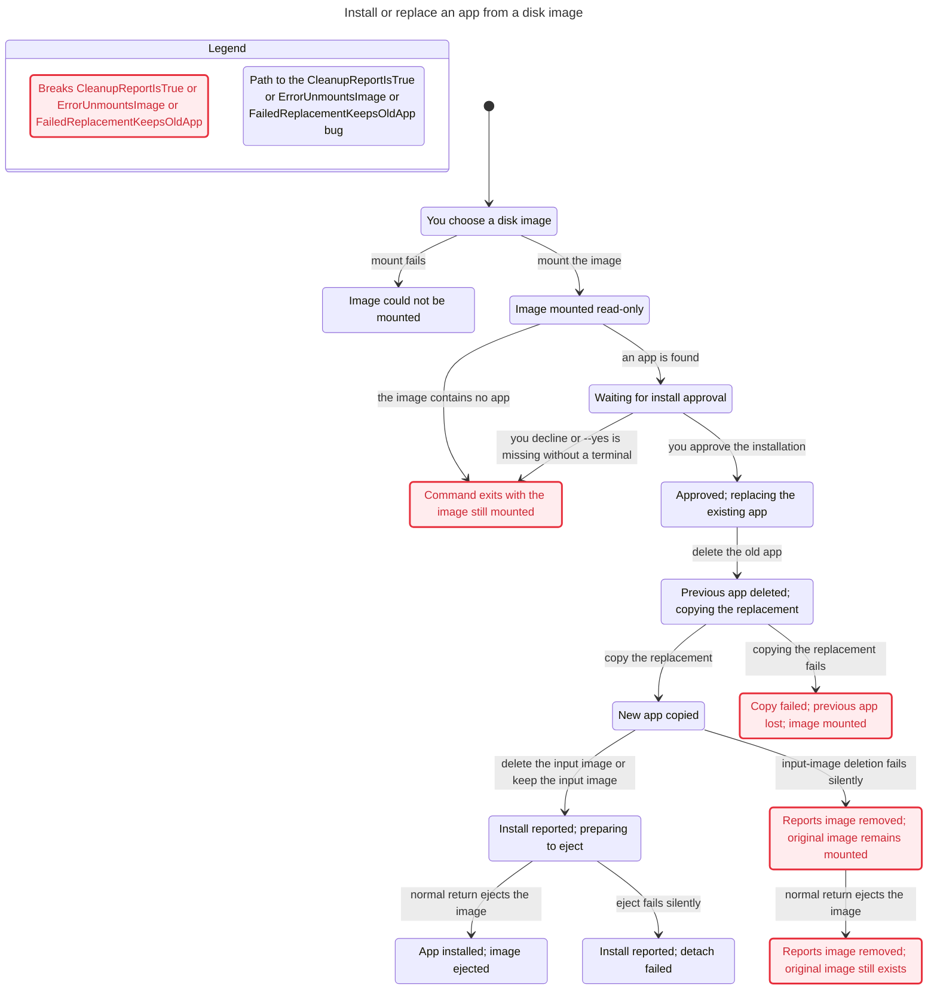

## Open and leave the dashboard

[Subsystem skill](../.agents/skills/terminal-session/SKILL.md) · [TLC report](results/terminal-session/report.md) · [SVG](results/terminal-session/chart.svg) · [Source replay evidence](results/terminal-session/evidence.json)

One terminal session: piped output, saved settings, raw mode, alternate screen, normal quit, handled fatal signal, idempotent cleanup. The complete TUI enum is compiled from source and tested on real pseudo-terminals with q and SIGTERM; all termios fields and the cursor/alternate-screen restore sequence are compared. SIGKILL, startup signals before failsafe registration, resize and Unicode input are excluded.


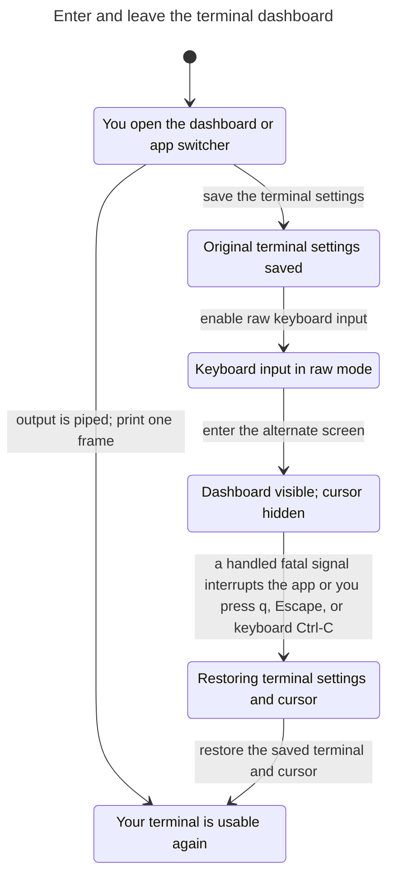

## Keep the Mac awake

[Subsystem skill](../.agents/skills/keep-awake/SKILL.md) · [TLC report](results/keep-awake/report.md) · [SVG](results/keep-awake/chart.svg) · [Source replay evidence](results/keep-awake/evidence.json)

One assertion; duration/PID completion and indefinite SIGINT waiting. The actual run body uses fake IOPM calls, real signal dispatch and Thread.sleep; the child is killed after SIGINT fails to complete. No real power assertion is acquired. PID reuse, EPERM, wall-clock jumps and SIGTERM are excluded.


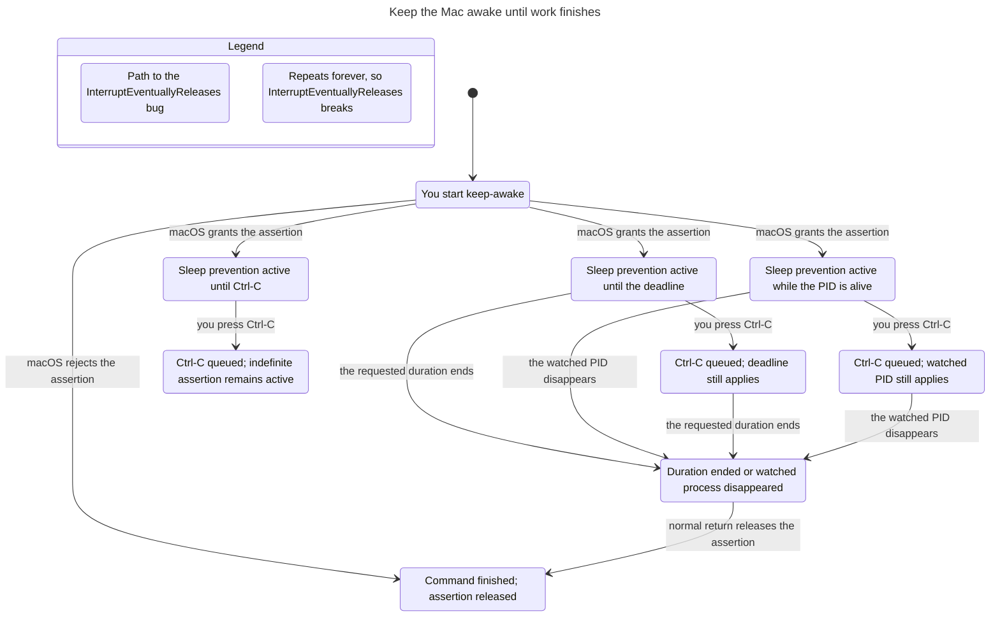

## Refresh agent usage

[Subsystem skill](../.agents/skills/usage-index/SKILL.md) · [TLC report](results/usage-index/report.md) · [SVG](results/usage-index/chart.svg) · [Source replay evidence](results/usage-index/evidence.json)

One file, two usage records, unchanged reuse, a partial-line completion and full reindex. Values 1/2 in the model represent 10/15 in the real source replay. Arithmetic and parsing execute on actual source over scratch JSONL fixtures. Same-size rewrites, cross-process index writes, budget edges, malformed JSON and today-by-mtime semantics are excluded.


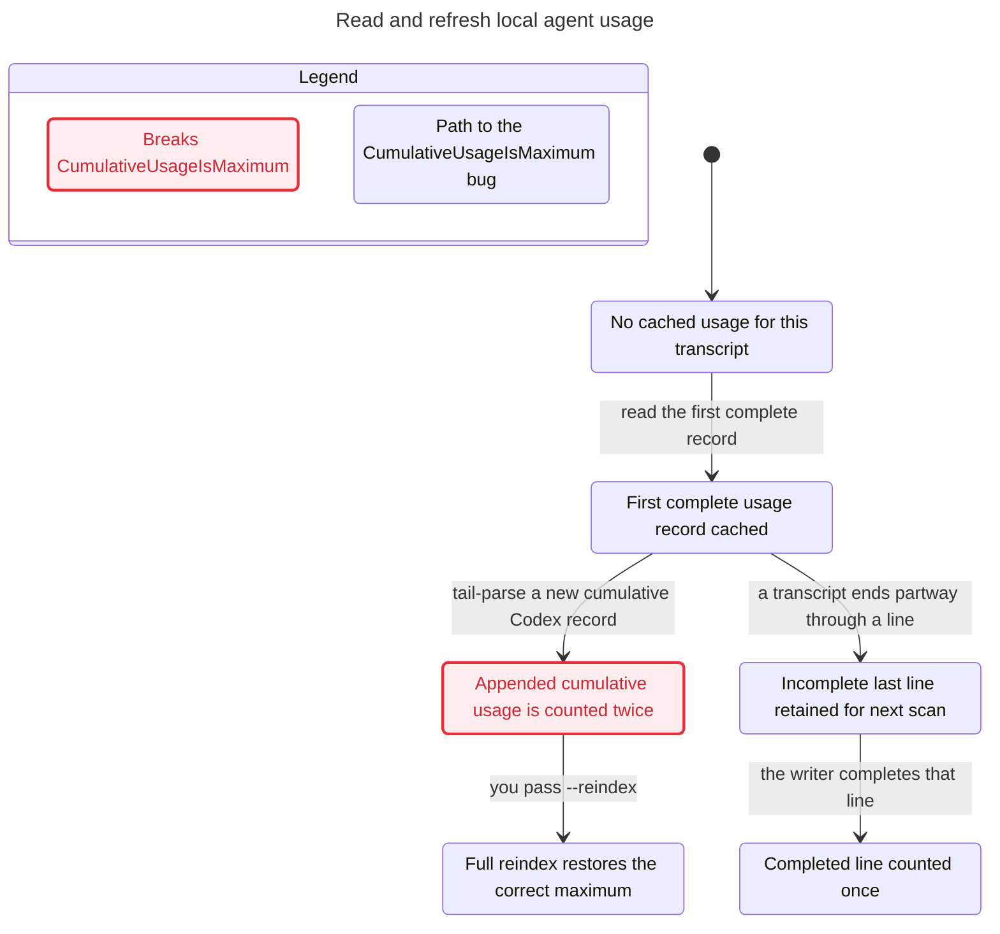

## Set a fan target

[Subsystem skill](../.agents/skills/fan-control/SKILL.md) · [TLC report](results/fan-control/report.md) · [SVG](results/fan-control/chart.svg) · [Source replay evidence](results/fan-control/evidence.json)

One valid fan, a validated in-range RPM, optional forced-bit support, and accepted/rejected/mismatching firmware responses. Actual Set.run executes against fake SMC dependencies. Physical cooling, SMC encoding, range arithmetic, concurrent commands, fans auto and audio routing are excluded.


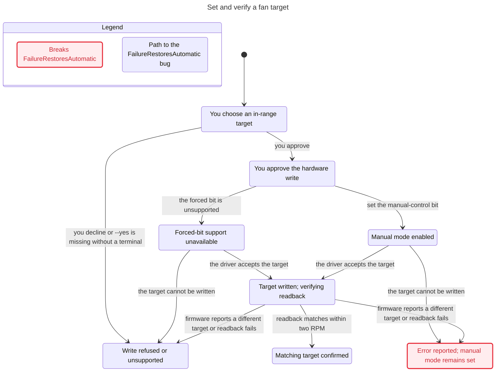

## Take a camera photo

[Subsystem skill](../.agents/skills/camera-capture/SKILL.md) · [TLC report](results/camera-capture/report.md) · [SVG](results/camera-capture/chart.svg) · [Source replay evidence](results/camera-capture/evidence.json)

One session, one frame, permission denial, frame timeout and encoding/write failure. The replay extracts the actual start/defer/first-frame block; conversion and disk-write failures share the same Out.fail abstraction but are not individually injected. OS cleanup on process exit is outside the explicit-cleanup invariant.


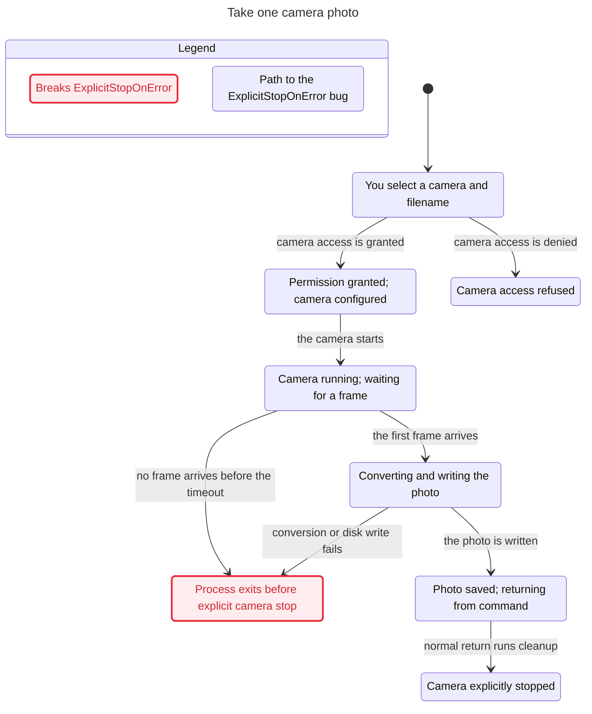
